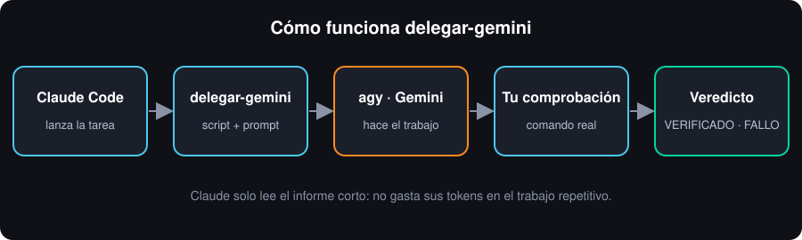
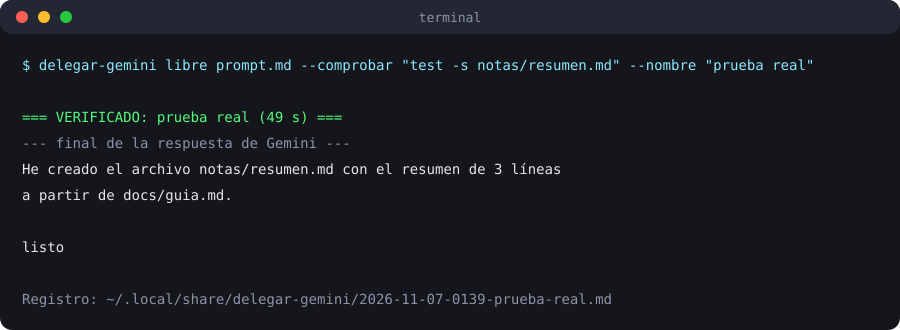

# delegar-gemini: una skill para que Claude Code delegue a Gemini

[English version](README.en.md)

Una skill de Claude Code y un script pequeno que permiten a Claude **delegar tareas rutinarias a Gemini** usando la terminal `agy` (Antigravity CLI) con tu suscripcion de Gemini. Claude lanza la tarea, y solo lee un informe corto con un veredicto, en vez de gastar sus propios tokens en trabajo repetitivo.

<p align="center"></p>

## Para que sirve
Cuando se te acaban los tokens de Claude, lo repetitivo y facil de verificar (documentar, resumir, buscar, generar configuracion con una herramienta tuya) no necesita su criterio. El script:
1. Envia tu prompt a Gemini con `agy --model <modelo> -p <prompt>`.
2. Opcionalmente ejecuta **tu comando de comprobacion** contra el estado real cuando Gemini termina.
3. Guarda prompt, respuesta y veredicto en un registro y muestra un informe corto (VERIFICADO / FALLO LA COMPROBACION / SIN COMPROBACION AUTOMATICA).

La idea clave: no confiar en lo que Gemini *dice* que hizo (otros modelos han narrado acciones sin ejecutarlas), sino **comprobar contra el estado real** con un comando determinista.

## Requisitos
- Linux, macOS o **Windows 10/11** con Python 3 (en Windows: `python --version` debe funcionar en cmd o PowerShell).
- Claude Code instalado.
- `agy` (Antigravity CLI) instalado y con sesion iniciada con una cuenta con suscripcion de Gemini. Verifica con `agy models` que el modelo existe.

## Instalacion
```bash
git clone https://github.com/ernessx/delegar-gemini.git && cd delegar-gemini
mkdir -p ~/.local/bin ~/.claude/skills/delegar-gemini
cp scripts/delegar-gemini ~/.local/bin/ && chmod +x ~/.local/bin/delegar-gemini
cp skill/SKILL.md ~/.claude/skills/delegar-gemini/SKILL.md
```
Asegurate de que `~/.local/bin` este en tu `PATH`. Si `agy` no esta en el PATH: `export DELEGAR_AGY=<RUTA>/agy`.

### Instalacion en Windows (PowerShell)
```powershell
git clone https://github.com/ernessx/delegar-gemini.git; cd delegar-gemini
New-Item -ItemType Directory -Force "$env:USERPROFILE\.local\bin", "$env:USERPROFILE\.claude\skills\delegar-gemini" | Out-Null
Copy-Item scripts\delegar-gemini, scripts\delegar-gemini.cmd "$env:USERPROFILE\.local\bin\"
Copy-Item skill\SKILL.md "$env:USERPROFILE\.claude\skills\delegar-gemini\SKILL.md"
```
Agrega `%USERPROFILE%\.local\bin` a tu PATH de usuario (Configuracion → Variables de entorno) y abre una terminal nueva. Si `agy` no se encuentra: `$env:DELEGAR_AGY = "C:\ruta\a\agy.exe"`. El archivo `delegar-gemini.cmd` es un atajo que llama a Python con el script.

## Uso
Archivo `prompt.md`:
```
Crea el archivo notas/resumen.md con un resumen de 5 lineas de docs/guia.md. No toques otros archivos. Termina con 3 lineas de resumen.
```
Ejecucion (mejor en segundo plano; puede tardar minutos):
```bash
delegar-gemini libre prompt.md --comprobar "test -s notas/resumen.md" --nombre "resumen guia"
delegar-gemini historial
```
En Windows el comando de comprobacion no puede usar `test`; usa por ejemplo `--comprobar "if exist notas\resumen.md (exit 0) else (exit 1)"` en cmd, o algo portable como `--comprobar "python -c \"import os,sys;sys.exit(0 if os.path.getsize('notas/resumen.md') else 1)\""`.

Salida de ejemplo (prueba real con `agy`):

<p align="center"></p>

Variables opcionales: `DELEGAR_AGY`, `DELEGAR_MODELO` (por defecto `gemini-3.8-flash-high`), `DELEGAR_CWD`, `DELEGAR_SALIDA` (por defecto `~/.local/share/delegar-gemini`), `DELEGAR_TIMEOUT`.

En Claude Code, la skill le indica a Claude cuando y como usarlo; puedes pedirle "delega esto a Gemini".

## Politica de confianza
**Si delegar:** tareas repetitivas, acotadas y verificables con un comando.
**No delegar:** diagnosticos sin causa clara, cableado/seguridad, decisiones de diseno, compras, cambios de infraestructura, nada con riesgo.

Reglas:
1. La **primera vez** de un tipo de tarea nuevo, revisa el resultado a mano aunque la comprobacion pase.
2. Despues, si el veredicto es VERIFICADO, no hace falta revisar a mano.
3. Si falla la comprobacion o no hay comprobacion, revisa y corrige tu.
4. Siempre verifica contra el estado real, no contra el relato del modelo.
5. No des a Gemini comandos genericos (`cat`, `grep`, `sudo`): podria leer secretos y enviarlos al modelo. Prefiere exponer una herramienta acotada.
6. Nunca pongas claves en el prompt.

## Por que `agy` con suscripcion y no la API gratuita
La API gratuita de Gemini (tier gratis) exige compartir los datos con Google. La suscripcion usada via `agy` es el canal privado. Por eso este proyecto solo usa `agy`.

## Limitaciones conocidas
- Es la version **generalizada** del script original del autor y **no incluye sus recetas**: cada usuario crea las suyas con Gemini. Este script generalizado **se probo con `agy` real en Linux** (tarea pequena, veredicto VERIFICADO); la logica de lanzamiento (`agy --model M --print-timeout T -p PROMPT`) es la del original.
- **Windows: por verificar.** El script esta escrito para ser multiplataforma (rutas, codificacion UTF-8, `agy.exe`/`agy.cmd`), pero **no se ha probado en Windows** (solo en Linux). Si algo falla, abre un issue con el error. Los prompts muy largos pueden chocar con el limite de ~32 000 caracteres de la linea de comandos de Windows.
- Por verificar: nombres exactos de las opciones de `agy` en tu version (`agy --help`) y modelos disponibles (`agy models`).
- Por verificar: el comportamiento con archivos muy grandes en el prompt (el autor vio fallos con otro wrapper MCP, no con `agy` directo).
- Gemini puede necesitar permisos en la configuracion de `agy` (lista de comandos permitidos/denegados); si una tarea falla por permisos, ajusta esa configuracion con cuidado (por verificar el formato exacto en tu version).
- Las comprobaciones son tu responsabilidad: el script solo ejecuta el comando que le pases.

## Como agregar una receta
El original usaba recetas en Python: una funcion que arma el prompt y una funcion de comprobacion que compara el estado antes/despues. Para este script generalizado, lo equivalente es guardar un prompt-plantilla y un script de comprobacion y llamarlos con `libre ... --comprobar`. Toda receta debe llevar comprobaciones deterministas y probarse primero en un caso reversible.

## Licencia
MIT, ver `LICENSE`.

## Creditos
Idea, direccion y pruebas: Ernes ([@ernessx](https://github.com/ernessx)). Desarrollado en colaboracion con Claude (Anthropic).
